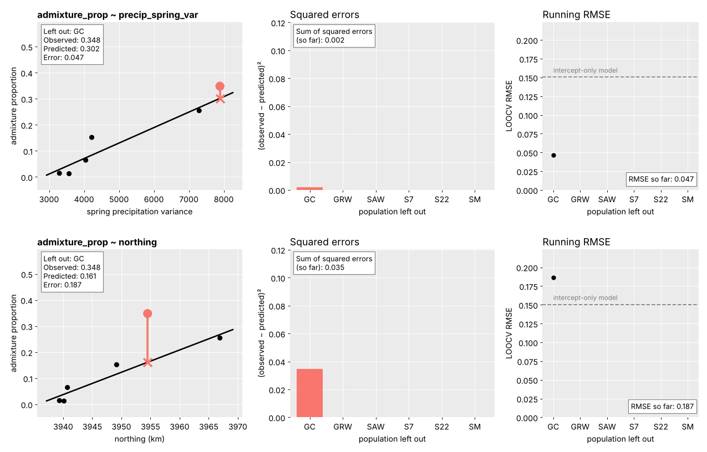

# X1. Model Evaluation {.unnumbered #model_evaluation}


```{r}
#| echo: false
#| message: false
#| warning: false
library(ggforce)
library(ggExtra)
library(knitr)
library(dplyr)
library(kableExtra)
library(ggfortify)
library(emmeans)
library(readr)
library(stringr)
library(infer)
library(ggthemes)
library(DT)
library(webexercises)
library(ggplot2)
library(tidyr)
library(cowplot)
library(gridExtra)
library(janitor)
library(forcats)
library(broom)
library(car)
source("../_common.R") 

hz_link <- "https://raw.githubusercontent.com/ybrandvain/datasets/refs/heads/master/zones_df_admix_weight_cutoff0.9_gps_dist2het_phenos_excl_GC.csv"

clarkia_hz <- read_csv(hz_link)|> 
  select(-weighted)|>
  rename(admix_proportion = `cutoff0.9`) |>
  dplyr::filter(!is.na(admix_proportion))|>
  clean_names() |>
  mutate(site = if_else(site == "SAW", "SR", site)) |>
  dplyr::filter(subsp=="P")|>
  mutate(site = fct_reorder(site, mean_petal_area_sq_cm))
gg_color_hue <- function(n) {
  hues = seq(15, 375, length = n + 1)
  hcl(h = hues, l = 65, c = 100)[1:n]
}

```


::: {.motivation style="background-color: #ffe6f7; padding: 10px; border: 1px solid #ddd; border-radius: 5px;"}

**Motivating Scenario:** You have built (or are in the process of building) a model. You can estimate parameters (with uncertainty) and test null hypotheses etc... But how can you tell if your model is any good?  

- **Distinguish** between "rejecting the null" from "having a good alternative"

- **Use plots and simulations** to judge whether a model captures key patterns in data.  

- **Interpret** residual, QQ, and leverage plots to spot nonlinearity, heteroscedasticity, or outliers.    

- **Compare models** using adjusted $R^2$, AIC, and log-likelihood, and explain how they penalize complexity.     

- **Use cross-validation** (LOOCV and k-fold) to assess predictive performance and avoid overfitting.   

- **Reflect** on when a more complex model is worth it vs when a simpler one is preferable.  

:::


---

> - "*All models are wrong, but some are useful.*" George Box.    
>     
>     
> - "*A map is not the territory it represents, but, if correct, it has a similar structure to the territory, which accounts for its usefulness.*"     Alfred Korzybski.   
>     
>     
>  - "*Truth is much too complicated to allow anything but approximations.*"    John von Neumann.
>     
>     

---

# Goals of model building  
Biology is messy and complex. Rarely can we fully grasp the workings of any biological phenomenon. Our brains need help to navigate this complexity. A simplified mathematical or conceptual representation of a biological system, known as a "model", can simplify complex systems to allow us to understand them. Good models highlight key relationships, test hypotheses, or make predictions from a few key features of a system. By focusing on the most relevant factors and ignoring extraneous details, models allow us to simplify complex biological systems into things we can understand. 

For example, statistical models (e.g. regression) can show how a trait (e.g. body size) is influenced by environmental factors (e.g. calories consumed per day), while a biological model like a Holliday junction helps us visualize the molecular mechanics of DNA recombination. Neither of these models  completely describes reality, but I cannot get my head inside a developing organism or the process of meiosis, so these models are a  good start.


But what are the "*most relevant factors*" to focus on, and what "*extraneous details*" can we ignore? To a large extent, this depends on the type of model we are building and what we want the model to achieve. Models are tools, and just like trying to bang in a nail with a saw would be ineffective and dangerous, the wrong model can mislead and confuse.  

- If our goal is to build a model for prediction, we prioritize how well it performs on new observations, often favoring predictive accuracy over interpretability. 
- On the other hand, if our aim is to understand a biological system, we might prefer a simpler model with fewer variables that explains much of the system’s behavior, rather than a more complex model that explains even more but at the cost of clarity.   
- If our goal is to understand the biological process that generates our data, we might explicitly incorporate plausible causal mechanisms into the model. This often involves paying close attention to the distributions underlying the data rather than relying on the fact that many models are robust to violations of the normality assumption.

While there are some guidelines for what makes a good or bad model, the things we care about most in our statistical models can depend on which of these missions we are undertaking.

## Model fit vs model adequacy  

There are three rough ways we can think about answering the question "Is my model any good?"  We can ask 

- "Does my model fit the data well?"   
- "Is my model an adequate description of the process?"   
- "Are my conclusions from null hypothesis significance testing and/or my uncertainty estimates justified?"  

:::aside

I won't focus on "*Are my conclusions from null hypothesis significance testing and/or my uncertainty estimates justified?*" here. You can evaluate this question by permutation (for nhst) and bootstrapping (for estimating uncertainty). 

:::

### Visualize your data and your model!

The first step in evaluating the quality of your model is to visually inspect it along with the raw data. Your eyes are often better at detecting unusual patterns than most calculations!

For example, suppose you want to determine whether sepal width reliably predicts petal length in the iris dataset. You might observe a significantly negative association: as sepal width increases, petal length decreases ($r^2 = 0.18$). Not what I would have expected, but ok...

```{r}
lm(Petal.Length ~ Sepal.Width, data = iris) %>%
  tidy()                                                                                                                                  %>% mutate_at(2:4, round,digits=3)%>% mutate(p.value = p.value* c(10^17,10^8), p.value =round(p.value, digits = 2), p.value = paste(p.value,c("x 10^-17", "x 10^-8")))%>% gt()
```

However, looking at the data reveals that this model is pretty bad. As you can see in  @fig-modelview. The overall negative relationship is driven by differences between three clusters (which we know to correspond to species). Within each cluster, the relationship appears positive.

```{r}
#| label: fig-modelview
#| fig-cap: "Showing the data helps us evaluate model fit." 
#| echo: false
#| fig-height: 4
#| fig-width: 9
#| message: false 
#| warning: false 
a <- ggplot(iris , aes(x = Sepal.Width, y = Petal.Length))+
  geom_smooth(method = "lm")+
  geom_point(color = NA)+
  theme(axis.title = element_text(size = 15),axis.text = element_text(size = 12))
b <- ggplot(iris , aes(x = Sepal.Width, y = Petal.Length))+
  geom_point()+
  geom_smooth(method = "lm")+
  theme(axis.title = element_text(size = 15),axis.text = element_text(size = 12))

a+b+plot_annotation(tag_levels = 'A')
```


### Simulation to help the eye  

Our eyes and brains are often quite good at spotting unusual patterns in plots. However, they can sometimes over-interpret what they see. Simple simulations are a great way to train ourselves to recognize normal variability, such as that arising from sampling error. The simplest simulation models observations as their expected values from the model plus random noise, based on the variability in the residuals. 

As shown in @fig-modelsim, the patterns in the real data differ noticeably from the patterns in three simulated datasets generated from the model.

```{r}
sim_data <- lm(Petal.Length ~ Sepal.Width, data = iris) |>
  augment() |>
  mutate(
    `Simulation 1` = rnorm(n(), mean = .fitted, sd = sd(.resid)),
    `Simulation 2` = rnorm(n(), mean = .fitted, sd = sd(.resid)),
    `Simulation 3` = rnorm(n(), mean = .fitted, sd = sd(.resid)),
    Observed = Petal.Length
  )
```

```{r}
#| label: fig-modelsim 
#| fig-cap:  "Simulation helps us evaluate model fit. Real data are shown with large black points; data from three simulations are shown in reddish colors."
#| fig-height: 2
#| fig-width: 4.5
#| message: false
#| warning: false
#| column: page-right
#| code-fold: true

sim_data |>pivot_longer(
    cols = starts_with("Simulation"),
    names_to = "simulation",
    values_to = "sim_petal_length"
  ) |>
  ggplot(aes(x = Sepal.Width)) +
  geom_point(aes(y = sim_petal_length, color = "Simulated"), alpha = 0.5) +
  geom_point(aes(y = Petal.Length, color = "Observed"), alpha = 0.5) +
    geom_line(aes(y = .fitted), color = "black") +
  facet_wrap(~ simulation, ncol = 3) +
  scale_color_manual(values = c("Observed" = "black", "Simulated" = "firebrick")) +
  labs(x = "Sepal width", y = "Petal length",color = "Data")+
  theme(#legend.position = "bottom", 
        axis.text = element_text(size = 5),
        axis.title = element_text(size = 7),
        legend.text = element_text(size = 5),
        legend.title = element_text(size = 7),
        strip.text = element_text(size = 7))
```


By contrast, the data and simulations look more similar when we include species in our model (@fig-modelsim2).

```{r} 
#| label: fig-modelsim2
#| fig-cap: "Simulation helps us evaluate model fit. Real data are shown with large black points; data from three simulations are shown in reddish colors."
#| fig-height: 2
#| fig-width: 4.5
#| column: page-right
#| message: false
#| warning: false
#| echo: false
#| 
lm(Petal.Length ~ Species + Sepal.Width, data = iris) %>% 
  augment() %>%
  mutate(
    sim_petal_length_a = rnorm(n(), mean = .fitted, sd = sd(.resid)),
    sim_petal_length_b = rnorm(n(), mean = .fitted, sd = sd(.resid)),
    sim_petal_length_c = rnorm(n(), mean = .fitted, sd = sd(.resid))
  ) %>%
  ggplot(aes(x = Sepal.Width, y = Petal.Length)) +
  geom_smooth(method = 'lm', se = FALSE) +
  geom_point(size = 2, alpha = 0.8) +
  geom_point(aes(y = sim_petal_length_a), color = "red", alpha = 0.3) +
  geom_point(aes(y = sim_petal_length_b), color = "pink", alpha = 0.3) +
  geom_point(aes(y = sim_petal_length_c), color = "firebrick", alpha = 0.3) +
  facet_wrap(~Species)+  
  theme(#legend.position = "bottom", 
        axis.text = element_text(size = 5),
        axis.title = element_text(size = 7),
        legend.text = element_text(size = 5),
        legend.title = element_text(size = 7),
        strip.text = element_text(size = 7))
```

### Multivariate visualizations     

The visualizations above can be pretty helpful, but we are most often worried about the fit and performance of more complex models with numerous predictors. What to do then? One approach is to use residual plots to check for patterns in the unexplained variation. For example, you can create residual plots (i.e. residuals are on the y and a focal predictor is on the x) for each predictor in your model to check for non-linear trends and/or unequal variance across levels of that predictor. 

For example @fig-residplot clearly shows the difference in variance across species in our residuals from model predictions of petal length as a function of sepal width and species.

```{r} 
#| label: fig-residplot
#| fig-cap: "Residual plots can help us evaluate assumptions." 
#| fig-height: 4
#| fig-width: 11
#| message: false
#| warning: false
a <- lm(Petal.Length ~ Species + Sepal.Width, data = iris) %>% 
  augment()%>%
  ggplot(aes(x = Sepal.Width, y = .resid))+
  geom_point()+
  theme(axis.title = element_text(size = 15), axis.text = element_text(size = 12))

b <- lm(Petal.Length ~ Species + Sepal.Width, data = iris) %>% 
  augment()%>%
  ggplot(aes(x = Species, y = .resid))+
  geom_sina() +
  theme(axis.title = element_text(size = 15), axis.text = element_text(size = 12))

a+b +plot_annotation(tag_levels = "A")
```


# Model diagnostics 


People often worry about if data meet the assumptions of the model used because they worry about e.g. if p-values or confidence intervals are well-calibrated. Although we shouldn't fully write off such concerns, linear models are remarkably robust to minor violations of these assumptions. Here we consider something more important about these violation -- they suggest that our model poorly captures the underlying biological process that we profess to be interested in. In this view we treat violations of assumption not as a challenge to be overcome by transformation, or an issue to be sidestepped by "non-parametric" tests, but rather as a signal that a different model could tell us more about the biology. 


Here are some examples of how violations of linear model assumptions can provide insights into underlying biology:

- **Differences in variance:** The treatment may not only influence the group means but also alter the variability within groups. This is exciting, as it suggests additional more fun biology!  

- **Non-independence:** Patterns or relationships among the subjects in our study could indicate interesting biological interactions or grouping effects. 

- **Non-normality of residuals** Non normal residuals can suggest an interesting process that generated the data.  For example, in [their study of how marine bacteria encounter food](https://www.pnas.org/doi/10.1073/pnas.2521542123), Thomas Day and Julia Schwartzman, realized that these discrete encounters are better described by a Poisson than a normal distribution. This model revealed a biological trade-off: larger bacterial groups encounter resources more consistently but receive fewer resources per cell. This could provide a benefit to joining a large group when the environment is likely to fluctuate.

### Interpreting diagnostic plots

Above, we visualized the raw data (potentially aided by simulations), and residual plots as ways to evaluate our model. We can also make use of the standard "diagnostic plots" we have seen previously:


#### Residual vs Fitted and Scale-Location plots

Linear models assume that residuals and their variance are independent of predictors. These two plots help us evaluate these assumptions. 

The **Residuals vs Fitted** plot is useful for identifying patterns in residuals that may indicate issues such as non-linearity, missing predictors, or systematic biases in the model. In this plot, the x-axis represents the model's predicted values, while the y-axis shows the residuals. Ideally, the residuals should appear as a random scatter around zero, with no discernible patterns, indicating no systematic deviations. Clear patterns in the residuals, as seen in the left panel of @fig-residloc1, suggest potential problems with the model. 

While heteroscedasticity (non-constant variance) can be observed in the Residuals vs Fitted plot—for example, larger residual variance for higher fitted values, as shown in the left panel of @fig-residloc2 -- the **Scale-Location** plot is specifically designed to highlight this issue. This plot focuses on the magnitude of the residuals rather than their direction by plotting the square root of the standardized residuals on the y-axis. Similar to the Residuals vs Fitted plot, a random scatter of points in the Scale-Location plot suggests the model fits well. However, a clear pattern, such as the linear trend in the right panel of @fig-residloc2, would indicate heteroscedasticity.


```{r}
#| label: fig-residloc1
#| fig-cap: "Residual vs Fitted and Scale-Location for the model, Petal.Length ~ Sepal.Width."
#| fig-height: 4
#| fig-width: 11
#| message: false
#| warning: false
autoplot(lm(Petal.Length ~ Sepal.Width, data = iris), which = c(1,3))                                                                                                  +labs(title = "Petal.Length ~ Sepal.Width")
```

```{r} 
#| label: fig-residloc2
#| fig-cap: "Residual vs Fitted and Scale-Location for the model, Petal.Length ~ Sepal.Width + Species."
#| fig-height: 4
#| fig-width: 11
#| message: false 
#| warning: false
autoplot(lm(Petal.Length ~ Sepal.Width+Species, data = iris), which = c(1,3))                                                                                                  +labs(title = "Petal.Length ~ Sepal.Width + Species")
```

#### QQ plots

We have already seen QQ (Quantile-Quantile) plots. QQ plots compare the quantiles of the residuals, to the quantiles of a theoretical distribution (the normal distribution for linear models). Residuals follow their expected distribution if they fall largely on the 1:1 line. A QQ plot with a curve bending the same way at both ends suggests skew (which can often be fixed by transformation). Diagnostic plots for our model  `lm(Petal.Length ~ Sepal.Width + Species, data = iris)` show that our large values are a bit too large. 

```{r} 
#| label: fig-qq
#| fig-cap: "A QQ plot from our model: Petal.Length ~ Sepal.Width + Species."
#| fig-height: 4 
#| fig-width: 11
#| message: false
#| warning: false 
#| echo: false
autoplot(lm(Petal.Length ~ Sepal.Width+Species, data = iris), which = c(2))                                                                                                  +labs(title = "Petal.Length ~ Sepal.Width + Species")
```


#### Residuals vs Leverage plots

We may be concerned that our model works too hard to explain a few extreme observations. The **Residuals vs Leverage** plot can help us diagnose this potential issue. Values in the top or bottom right corners would be most concerning patterns, because these would indicate points that heavily influenced our model.

```{r}
#| label: fig-resid_lev
#| fig-cap: "A Residuals vs Leverage plot from our model: Petal.Length ~ Sepal.Width + Species."
#| fig-height: 4
#| fig-width: 11
#| message: false
#| warning: false
#| echo: false

autoplot(lm(Petal.Length ~ Sepal.Width+Species, data = iris), which = c(6))                                                                                                  +labs(title = "Petal.Length ~ Sepal.Width + Species")
```


# Evaluating Model Fit

We have already discussed some basic summaries of how well our model fits the data:

- **$R^2$**: describes the proportion of variation in the response variable, $y$, that is "explained" by the model. A higher $R^2$ suggests that the model accounts for a larger share of the variation in the data. But  $R^2$ on its own can't tell us if our model is appropriate or correctly specified. What is considered a "good" $r^2$ varies across fields, experimental designs etc. 

- **Log-Likelihood**: The log-likelihood quantifies the probability of observing our data given that the model is true. Models that produce higher log-likelihood values (less negative) are generally better at describing the observed data. However, log-likelihoods are heavily influenced by the scale of the data and the number of observations, and larger datasets naturally produce lower log-likelihoods because the likelihood is the product of probabilities across all observations. Therefore, there is no intuitive scale for log-likelihoods, and they cannot be directly compared across datasets of different sizes or scales. 

Importantly, there are no universal "rules of thumb" for what makes a good or bad model based on these metrics. Additionally, both $r^2$ and the log-likelihood will appear to "improve" as the number of parameters increase, but that does not mean that adding parameters always improves our model.  

### Model comparison

#### Penalizing Additional Parameters

```{r} 
#| label: fig-modeclomp
#| fig-cap: "Two models predicting Petal length in the iris data set."
#| echo: false 
#| fig-height: 4
#| fig-width: 9 
#| message: false
a <- ggplot(iris , aes(x = Species, y = Petal.Length, color= Species))+
  geom_sina(show.legend = FALSE)+
  stat_summary(fun.data = mean_cl_normal,show.legend = FALSE, color = "black")+
  labs(title ="Petal Length ~ Species", subtitle = "r2 = 0.941")+
  theme(axis.title = element_text(size = 15),axis.text = element_text(size = 12))
b <- ggplot(iris , aes(x = Sepal.Width, y = Petal.Length, color= Species))+
  geom_point()+
  geom_smooth(method = "lm")+
  labs(title = "Petal Length ~ Species + Sepal.Width", subtitle = "r2 = 0.950")+
  theme(axis.title = element_text(size = 15),axis.text = element_text(size = 12))
a+b
```

Because adding parameters always appears to improve model fit, people have developed tools to evaluate whether an extra parameter is justified. So we might wonder if adding Sepal Width to our model of Petal Length as a function of Species is justified. Various approaches "penalize" a statistical model for including additional parameters. Here are a couple of widely used methods:

- **Adjusted  $R^2$ ** accounts for the number of predictors in the model and adjusts for overfitting. It is given by:  

$$R^2_{\text{adjusted}} = 1 - \left( \frac{(1 - R^2)(n - 1)}{\text{df}_\text{error}} \right)$$

Unlike  $R^2$ , the adjusted  $R^2$  can **decrease** as we add parameters, indicating that the added complexity does not sufficiently improve model fit. So, don’t get overly excited about an increase in  $R^2$  from adding a variable—be sure to check the change in adjusted  $R^2$  as well.

- **AIC penalizes the log-likelihood.** Specifically, AIC is calculated as:  
$$2\times\left((k+1) - \ln(\widehat{L})\right)$$
  where $k$  is the number of parameters in the model (e.g. the slope and intercept), the `+1` accounts for the residual variance (which we also estimate), and $\ln(\widehat{L})$ is the log-likelihood of the model. A lower AIC indicates a model that better balnces fit and complexity. In general, a decrease in AIC of **at least 2** (approximately equivalent to a two-standard-error improvement when adding one parameter) is considered evidence to prefer the model with more parameters. 
  
R is happy to calculate these values for us. The adjusted $R^2$ value is provided from the `summary()`function, and the `AIC()` function will return the AIC of your model. Even better, the `glance()` function in the `broom` package gives us these values and more.  

Say we were interested in comparing our model predicting petal length as a function of iris species to a model which included both species and Sepal. We can write down the two models in @fig-modeclomp: 

```{r}
species_only_model   <- lm(Petal.Length ~ Species,data = iris)
glance(species_only_model)                                                                                                                   %>% kbl()
species_and_SW_model <- lm(Petal.Length ~ Species + Sepal.Width ,data = iris)
glance(species_and_SW_model)                                                                                                                   %>% kbl()
``` 

We can see here that there is statistical evidence to prefer  the model with Sepal Width and Species over the model with just species -- the adjusted $R^2$ has increased and the AIC went down by more than twenty units!

**Note** this does not mean we should necessarily choose the model with Sepal Length in addition to species. We should think about our goals and priorities when making a model. In this case  adding  this additional parameter explains an additional one percent of  the variation in Petal Length. Another way to say this is that an overwhelming proportion of the variance in petal length is attributable to variation between species. So if you are looking for a short petal  getting one from *Iris setosa* would be a pretty safe bet. But if you want your predictions to be even more accurate, knowing sepal width would help. 

:::warning 
Just because metrics like AIC or adjusted $R^2$ favor one model does not mean it is universally "better." Choosing a model depends on many factors: does it reflect the biological process? Does it fit assumptions? Is it simpler or easier to interpret? Does it predict future data more accurately? Better should refer to "better for what." Always consider the specific goals of your analysis.
:::


# Model evaluation: Predictive Performance


> "With four parameters I can fit an elephant, and with five I can make him wiggle his trunk"
>
>  von Neumann to Fermi according to Freeman Dyson. 


Rather than relying solely on simple measures of significant model improvement (e.g., AIC, BIC, adjusted  $R^2$ , etc.), we are often more practically interested in how well our model predicts new data. This is challenging because we typically have access only to our existing data. But we can approximate this task by building models using a portion of the data and seeing how well we can predict the "hold-out" data that the model was not trained on. This "cross-validation" is especially usefull in evaluating if a  model has *overfit* the data.


### Leave one out cross validation

I am interested in the features that mediate how much gene flow can occur during the process of speciation. With my collaborators we estimated the admixture proportion in *Clarkia xantiana xantiana* (i.e. the proportion of a populations' genome which is derived from recent hybridization with its sister subspecies, *Clarkia xantiana parviflora*). The data were hard to get -- and we only have so many populations to choose from.  We ultimately estimated the admixture proportion across six populations for which we had complementary data (geography and temperature). 

We honed in on two promising predictors -- the variation in spring precipitation, and how far north a population was. Individually each term was significant, but together neither was significant, likely because of multicollinearity (@fig-admix). 

```{r}
admixture <- read_csv("https://raw.githubusercontent.com/ybrandvain/datasets/refs/heads/master/admix_sites.csv")
lm(admixture_prop ~ northing , data =admixture)  %>%   Anova(type = "II")                                                                                                                                                                                               %>% tidy()%>% mutate_at(2:5, round, digits=4) %>%  gt() %>%  tab_header(title = "admixture_prop ~ northing")
lm(admixture_prop ~ precip_spring_var, data =admixture) %>%  Anova(type = "II")                                                                                                                                                               %>% tidy()%>% mutate_at(2:5, round, digits=4) %>%  gt() %>%  tab_header(title = "admixture_prop ~ precip_spring_var")

lm(admixture_prop ~ northing + precip_spring_var, data =admixture) %>%  Anova(type= "II")                                                                                                                                                                       %>% tidy() %>% mutate_at(2:5, round, digits=4) %>% gt() %>%  tab_header(title = "admixture_prop ~ northing + precip_spring_var")
```


```{r} 
#| label: fig-admix
#| fig-cap: "Relationship between northings, variance in spring precipitation, and admixture proportion."
#| echo: false
#| message: false
#| warning: false
#| fig-height: 4
#| fig-width: 9
a <- ggplot(admixture, aes(x = northing, y= admixture_prop))+
  geom_point(size= 3)+
  geom_smooth(method = "lm")+
    theme(axis.title = element_text(size = 15),axis.text = element_text(size = 12))

b <- ggplot(admixture, aes(x = precip_spring_var, y= admixture_prop))+
  geom_point(size= 3)+
  geom_smooth(method = "lm")+
  theme(axis.title = element_text(size = 15),axis.text = element_text(size = 12))

c <- ggplot(admixture, aes(x =  northing, y=  precip_spring_var))+
  geom_point(size= 3)+
  geom_smooth(method = "lm") +
  theme(axis.title = element_text(size = 15),axis.text = element_text(size = 12))

a+b+c
```

To evaluate the performance of these models, we conducted leave-one-out cross-validation (LOOCV). In LOOCV, we: 
1. Build a model with all but one data point.
2. Use this model to "predict" the value of the repsonse variable for this "held out" observation.  
3. We find the difference between the actual value and the prediction and square it (aka the squared error). 
4. Do this for all data points. 
5. Finf the root-mean squared error as the square root of the average of the mean squared error over all held out data points


Here's how you can do this with R's `caret` package:  

::: {.panel-tabset}

## Null model

```{r}
library(caret)
library(caret)

train(
  admixture_prop ~ null,
  data = admixture |> mutate(null = 0),
  method = "lm",
  trControl = trainControl(method = "LOOCV")
)
```

## Spring precipitation

```{r}
library(caret)
train(
  admixture_prop ~ precip_spring_var,
  data = admixture,
  method = "lm",
  trControl = trainControl(method = "LOOCV")
)
```

## Northing

```{r}
library(caret)
train(
  admixture_prop ~ northing,
  data = admixture,
  method = "lm",
  trControl = trainControl(method = "LOOCV")
)
```

## Both

```{r}
library(caret)
train(
  admixture_prop ~ precip_spring_var + northing,
  data = admixture,
  method = "lm",
  trControl = trainControl(method = "LOOCV")
)
```

:::

---

```{r}
#| label: fig-loocv
#| echo: false
#| column: page-right
#| fig-cap: "**Leave-one-out cross-validation for models of the admixture proportion in six *Clarkia xantiana* populations.** The animation loops accross all populations, leaving one out at a time.  (large red point). It fits the model to the remaining populations, and predicts the left-out population (red ✕). Admixture as a function of variance in spring precipitation, and  admixture as a function of northing are shown in the top and bottom panels, respectively. The **Middle panels** show squared prediction error for each focal population, and the **Right panels** track the running root mean squared error (RMSE) as we loop over hold-outs. The dashed line shows the RMSE for the intercept only model as a reference."
#| fig-alt: "Animated figure with two rows of three panels, cycling through six frames, one for each Clarkia population left out (GC, GRW, SAW, S7, S22, SM). Top row: admixture proportion versus variance in spring precipitation. Bottom row: admixture proportion versus northing in km. In each left panel, the left-out population is a large red point, a black line is fit to the remaining five, and a red X marks that line's prediction, with a red vertical segment showing the error. Middle panels are bar charts of squared prediction errors, one bar added per frame. Right panels show the running RMSE as a line rising or falling as each population is added, with a dashed horizontal line at 0.150 for an intercept-only model. In the top row, errors stay small and the running RMSE ends at 0.049, well below the dashed line. In the bottom row, errors are large for GC and especially S22, and the running RMSE ends at 0.151, about the same as the intercept-only model."

```

---

Our leave-one-out cross validation (illustrated in @fig-loocv) shows that a model using only `precip_spring_var` does a good job of predicting the "help-out" observation. By contrast, a model with only `northing` does no better at predicting the "hold-out" than that intercept-only model. This is sobering, as we did reject the null in in the "northing only" model. 

[Bu-bu-bu-but wait it gets worse](https://www.youtube.com/watch?v=7ADgCeYJMN4), a model with both `northing` and `precip_spring_var` are predicts of held-out data **worse** than the  `precip_spring_var` only model (@fig-rmse). 


```{r} 
#| label: fig-rmse
#| fig-cap: "Leave one out model validation."
#| echo: false
#| fig-height: 4
#| fig-width: 9
tibble(predictor = c("intercept","precip_spring_var","northing","precip_spring_var + northing"),
       RMSE = c(0.1504829, 0.04943208, 0.1508915,0.1359965))%>%
    ggplot(aes(x = RMSE, y = predictor ))+geom_col()+
  theme(axis.title = element_text(size = 15),axis.text = element_text(size = 12))
```


### K fold cross validation 


Leave-one-out cross-validation is useful, but it is best  for small datasets like the admixture analysis above. This is because it becomes computationally expensive for larger datasets (we need to run it as many times as there are observations). This computational expense is also not particularly well-spent -- because each training set is very similar (only one observation excluded in each iteration), models are highly correlated,  so you don't get much bang out of that extra computation. 

$k$-fold cross-validation splits the dataset into $k$  groups (or "folds"). We train the model on $(k-1)$ "folds" and tested on the remaining fold. We repeat this process $k$  times, each time leaving out a different fold as the test set. We then average results across all folds.  $k$-fold CV provides a more robust estimate of model performance. $k$-fold cross validation uses less compute. than leave one out cross validation, and the training sets differ more substantially across folds.

:::aside
**Leave-one-out cross validation** is a special class of "k-fold cross validation" where $k = n-1$.
:::


Because leave-one-out cross validation is a special case of k-forl cross validation (see aside above), the code for $k$-fold cross-validation in R's [`caret`](https://topepo.github.io/caret/) package is basically identical to that for LOOCV. The only difference is that with $k$-fold cross validation, you specify `trainControl(method = "cv", number = K)`, where `K` is the number of folds. By convention, $K = 10$ is most common.

As in leave one out cross validation you can compare  performance of more complex to simpler models with k fold cross validation, to see whether a more complex model makes better or worse predictions than a simpler model.


:::warning
**NOTE** cross-validation approaches are limited to the data at hand. This raises a real concern -- specific characteristics of your study (e.g., conditions that apply to soil in Minnesota may not apply to soil in South Dakota) will limit how well the model generalizes to different situations. So, always be careful in considering / explaining where our model is "validated".
:::


```{r}
#| eval: false
#| echo: false
library(tidyverse)
library(gganimate)
library(gifski)
library(magick)

gg_color_hue <- function(n) {
  hues = seq(15, 375, length = n + 1)
  hcl(h = hues, l = 65, c = 100)[1:n]
}
big_text <- theme(legend.position = "none",
                  axis.text = element_text(size = 16),
                  axis.title = element_text(size = 18),
                  strip.text = element_text(size = 18, face = "bold"),
                  plot.title = element_text(size = 26),
                  plot.subtitle = element_text(size = 16))

admixture <- read_csv("https://raw.githubusercontent.com/ybrandvain/datasets/refs/heads/master/admix_sites.csv") |>
  mutate(northing_km = northing / 1000)
n_sites <- nrow(admixture)

# The two models to compare, one row each
models <- tibble(model = c("admixture_prop ~ precip_spring_var", "admixture_prop ~ northing"),
                 xvar  = c("precip_spring_var", "northing_km")) |>
  mutate(model = factor(model, levels = model))

# Leave each population out in turn: fit to the rest, predict the one left out
loo <- pmap_dfr(models, function(model, xvar) {
  map_dfr(seq_len(n_sites), function(i) {
    fit <- lm(reformulate(xvar, "admixture_prop"), data = admixture[-i, ])
    tibble(model     = model,
           frame     = i,
           site      = admixture$site[i],
           x         = admixture[[xvar]][i],
           observed  = admixture$admixture_prop[i],
           predicted = predict(fit, newdata = admixture[i, ]),
           null_pred = mean(admixture$admixture_prop[-i]),
           intercept = coef(fit)[1],
           slope     = coef(fit)[2])
  })
}) |>
  group_by(model) |>
  mutate(error        = observed - predicted,
         sq_error     = error^2,
         running_rmse = sqrt(cumsum(sq_error) / frame)) |>
  ungroup()

null_rmse <- loo |> filter(model == levels(model)[1]) |>
  summarise(rmse = sqrt(mean((observed - null_pred)^2))) |> pull(rmse)   # about 0.150

# ---- Column A: the left-out population and the line fit without it ----
points_by_frame <- models |>
  pmap_dfr(function(model, xvar) admixture |>
             transmute(model = model, row = row_number(), x = .data[[xvar]], admixture_prop)) |>
  mutate(model = factor(model, levels = levels(models$model))) |>
  crossing(frame = seq_len(n_sites)) |>
  mutate(held_out = row == frame)

loo_plot_a <- ggplot(points_by_frame, aes(x = x, y = admixture_prop)) +
  geom_abline(data = loo, aes(intercept = intercept, slope = slope), linewidth = 1.2) +
  geom_segment(data = loo, aes(x = x, xend = x, y = predicted, yend = observed),
               color = gg_color_hue(2)[1], linewidth = 1.5, inherit.aes = FALSE) +
  geom_point(aes(color = held_out, size = held_out)) +
  geom_point(data = loo, aes(x = x, y = predicted), shape = 4, size = 6, stroke = 2,
             color = gg_color_hue(2)[1], inherit.aes = FALSE) +
  geom_label(data = loo,
             aes(x = -Inf, y = Inf,
                 label = paste0("Left out: ", site, "\nObserved: ", round(observed, 3),
                                "\nPredicted: ", round(predicted, 3), "\nError: ", round(error, 3))),
             hjust = -0.05, vjust = 1.1, size = 5, inherit.aes = FALSE) +
  scale_color_manual(values = c("FALSE" = "black", "TRUE" = gg_color_hue(2)[1])) +
  scale_size_manual(values = c("FALSE" = 3, "TRUE" = 6)) +
  facet_wrap(~ model, ncol = 1, scales = "free_x") +
  coord_cartesian(ylim = c(-0.05, 0.6)) +
  labs(title = "Leave one out",
       subtitle = "Fit to the other five (line), predict the one left out (x)",
       x = "spring precipitation variance (top) / northing in km (bottom)",
       y = "admixture proportion") +
  big_text +
  transition_manual(frame)

# ---- Column B: squared errors build up ----
sq_by_frame <- loo |>
  select(model, site, step = frame, sq_error) |>
  mutate(site = factor(site, levels = admixture$site)) |>
  crossing(display_frame = seq_len(n_sites)) |>
  filter(step <= display_frame) |>
  mutate(current = step == display_frame)

sq_labels <- loo |>
  group_by(model) |>
  transmute(display_frame = frame,
            label = paste0("Sum of squared errors\n(so far): ", round(cumsum(sq_error), 3))) |>
  ungroup()

loo_plot_b <- ggplot(sq_by_frame, aes(x = site, y = sq_error, alpha = current)) +
  geom_col(fill = gg_color_hue(2)[1]) +
  geom_label(data = sq_labels, aes(x = -Inf, y = Inf, label = label),
             hjust = -0.05, vjust = 1.1, size = 5, inherit.aes = FALSE) +
  scale_x_discrete(drop = FALSE) +
  scale_alpha_manual(values = c("TRUE" = 1, "FALSE" = 0.35)) +
  facet_wrap(~ model, ncol = 1) +
  coord_cartesian(ylim = c(0, max(loo$sq_error) * 1.25)) +
  labs(title = "Squared errors",
       subtitle = "Previous values are transparent.",
       x = "population left out",
       y = "(observed - predicted)²") +
  big_text +
  transition_manual(display_frame)

# ---- Column C: running LOOCV RMSE ----
loo_plot_c <- ggplot(loo, aes(x = frame, y = running_rmse)) +
  geom_hline(yintercept = null_rmse, linetype = "dashed", color = "grey40") +
  annotate("text", x = 1, y = null_rmse, label = "intercept-only model",
           hjust = 0, vjust = -0.5, size = 5, color = "grey40") +
  geom_line(color = "darkgreen", linewidth = 1.2) +
  geom_point(size = 3) +
  scale_x_continuous(breaks = seq_len(n_sites), labels = admixture$site) +
  facet_wrap(~ model, ncol = 1) +
  coord_cartesian(ylim = c(0, max(null_rmse, max(loo$running_rmse)) * 1.2)) +
  labs(title = "Running RMSE",
       subtitle = "sqrt(mean squared error so far)",
       x = "population left out",
       y = "LOOCV RMSE") +
  big_text +
  transition_reveal(along = frame)

# ---- Render each column with the same number of frames, then put them side by side ----
dir.create("figs/linear_models/model_evaluation", recursive = TRUE, showWarnings = FALSE)
anim_save("figs/linear_models/model_evaluation/loocv2_a.gif",
          animate(loo_plot_a, nframes = n_sites, fps = .4, width = 450, height = 830, renderer = gifski_renderer()))
anim_save("figs/linear_models/model_evaluation/loocv2_b.gif",
          animate(loo_plot_b, nframes = n_sites, fps = .4, width = 450, height = 830, renderer = gifski_renderer()))
anim_save("figs/linear_models/model_evaluation/loocv2_c.gif",
          animate(loo_plot_c, nframes = n_sites, fps = .4, width = 350, height = 830, renderer = gifski_renderer()))

gif1 <- image_read("figs/linear_models/model_evaluation/loocv2_a.gif")
gif2 <- image_read("figs/linear_models/model_evaluation/loocv2_b.gif")
gif3 <- image_read("figs/linear_models/model_evaluation/loocv2_c.gif")

combined <- image_append(c(gif1[1], gif2[1], gif3[1]))
for (i in 2:length(gif1)) {
  combined <- c(combined, image_append(c(gif1[i], gif2[i], gif3[i])))
}
image_write(image_animate(combined, fps = 0.4), "figs/linear_models/model_evaluation/loocv_precip_vs_northing.gif")
```