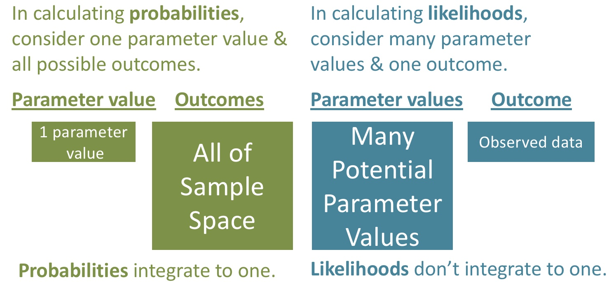

# X5. Probability and Likelihood {.unnumbered #probability_and_likelihood}


```{r}
#| echo: false
#| message: false
#| warning: false
# https://dpananos.github.io/posts/2024-06-23-confound/
library(ggforce)
library(ggExtra)
library(knitr)
library(dplyr)
library(kableExtra)
library(ggfortify)
library(emmeans)
library(readr)
library(stringr)
library(infer)
library(ggthemes)
library(DT)
library(webexercises)
library(ggplot2)
library(tidyr)
library(cowplot)
library(gridExtra)
library(janitor)
library(forcats)
library(broom)
library(tufte)
library(car)
source("../_common.R") 
html_tag_audio <- function(file, type = c("mp3")) {
  type <- match.arg(type)
  htmltools::tags$audio(
    controls = "",
    htmltools::tags$source(
      src = file,
      type = glue::glue("audio/{type}", type = type)
    )
  )
}

```


::: {.motivation style="background-color: #ffe6f7; padding: 10px; border: 1px solid #ddd; border-radius: 5px;"}


**Motivating Scenario:**  So far, we've used p-values, confidence intervals, and model coefficients as standard tools without thinking too hard about them. Probability and likelihood are the machinery underneath nearly every method in this book, from a t-test to a linear model. In this chapter we open the hood, build up probability and likelihood from scratch, and use them to fit and evaluate a simple model by hand. Along the way we'll also see that there's more than one coherent way to reason about uncertainty: the frequentist approach we've used so far, and the Bayesian approach, which asks a different question.

**Learning Goals:** By the end of this chapter, you should be able to:

1. Calculate and combine probabilities using the addition rule (OR) and multiplication rule (AND), and use Bayes' theorem to flip a conditional probability.

2. Distinguish a probability from a likelihood, and explain why we typically work with log-likelihoods rather than likelihoods directly.

3. Find a maximum likelihood estimate (MLE) by evaluating a likelihood profile across candidate parameter values.

4. Use likelihood-based methods to quantify uncertainty in an estimate and test a null hypothesis.

5. Apply these tools end to end on a real example, from raw data to a hypothesis test.

6. Contrast frequentist and Bayesian inference, and explain how a prior distribution combines with the likelihood to produce a posterior — including how sensitive that posterior is to the choice of prior.


:::


---

## A Very Brief Intro to Probability   

A theme of this book (and of all of statistics) is that nothing is truly certain. Outcomes are not inevitable. Rather, each possible outcome in a "sample space" carries some probability.

This -- of course -- does not mean that all outcomes are equally probable. For example, in NHST we reject the null hypothesis when our observations (or something more extreme) are an improbable outcome of the null sampling distribution. As such, the rules of probability play a key role in NHST specifically and all of statistics, more broadly. 

### Probability: Terms and Conditions Apply 

#### **Probabilities and conditional probabilities**   

There is a true probability that a specific outcome occurs. This "parameter" is the proportion of observations in an infinite number of trials that lead to our focal outcome. So $P(A)$ is the probability that thing A occurs. 


A simple example is a coin flip with two possible outcomes: heads or tails.  If the coin is "fair" these outcomes are equally probable. So, we say: 

$$P(\text{Heads} \mid \text{fair coin}) = 0.5$$

To unpack this notation a bit:  

```{r} 
#| label: fig-quarter
#| fig-cap: "The result of a coin flip is a classic example of a probabilistic outcome."
#| echo: false
#| fig-alt: "An image of a 1997 U.S. quarter, showing both sides of the coin. The left side features George Washingtons profile with the words LIBERTY and IN GOD WE TRUST, along with the year 1997 at the bottom. The right side displays the reverse of the coin, which shows a bald eagle with outstretched wings holding arrows and an olive branch, with the text UNITED STATES OF AMERICA and QUARTER DOLLAR inscribed around the edges."
#| column: margin

```

- **$P$** stands for probability. 
- **$P(\text{Heads})$** shows which outcome we are considering (in this case, seeing heads),    
- **$|\_\_$**. The vertical bar "|" means "given" or "under the condition of." This is the probability the coin shows heads, given that we know it is fair. Another word for this is that this is a **conditional probability.**   

Of course, not all coins are fair. If I gave you a trick coin that came up heads 75\% of the time, we would have:   

$$P(\text{Heads} \mid \text{Yaniv's trick coin}) = \frac{3}{4}$$   


As for any parameter, we almost never KNOW the true probability. Rather, we usually estimate it as the proportion $\hat{p}$:

$$\widehat{p} = \frac{\# \text{ of times the focal outcome occurred}}{\# \text{ of trials}}$$

:::note
**Independence and non-independence:** 

In some cases, knowing a condition does not provide additional information about the probability of the outcome. For example, my fair coin is  equally likely to come up heads any day of the week. So:

$$P(\text{Heads} \mid \text{fair on monday}) = P(\text{Heads} \mid \text{fair on tuesday}) = 0.5$$

Here the probability of heads, $P(\text{Heads})$, is independent of the day of the week.  If P(A|B) equals P(A), we say that A is independent of B. Similarly, the probability of rain is likely independent of the day of the week -- it's no less likely to rain on a Saturday than on a Wednesday.  

Other times, the condition matters, so probabilities are non-independent. For example the probability that it is rainy and sunny are likely non-independent -- $P\text{(rain | sunny)} \neq P\text{(rain | cloudy)}$ -- it's less likely to rain on sunny days than cloudy ones.  


:::

### Combining probabilities

We are often interested in more complex probabilities. For example: 

- What is the probability it rained or was cloudy?
- What is the probability it rained two days in a row?


#### **Add probabilities to find the probability of “OR”**

To find the probability that **A OR B** happened, we add the probability of A and the probability of B, and then subtract the probability of both happening so we don't double-count:

$$P(\text{A OR B}) = P(\text{A}) + P(\text{B}) - P(\text{A \& B})$$

As a concrete example, consider the probability that it’s raining or cloudy. These aren’t mutually exclusive events—rain usually comes with clouds—so:

$$P(\text{rain OR cloudy})= P(\text{rain}) + P(\text{cloudy}) - P(\text{rain AND cloudy})$$

:::aside 
Here the term, $P(\text{rain AND cloudy})$, is non-zero because it can be cloudy and rainy at the same time. 
:::

When A and B **cannot** happen at the same time (i.e., when they’re mutually exclusive), the overlap is zero. In that special case, the formula simplifies to:

$$P(\text{A OR B}) = P(\text{A}) + P(\text{B})$$

The last "OR" rule we need is the **law of total probability**. This says that the probability of some outcome is the sum of all the mutually exclusive ways that the outcome can occur. For example:

:::aside
More broadly, the **law of total probability** states:
$$P(B) = \sum P(B|A_i) \times P(A_i)$$
:::

$$P(\text{rain}) = P(\text{rain AND sunny}) + P(\text{rain AND cloudy})$$ $$=P(\text{rain | sunny})\times P(\text{sunny}) + P(\text{rain | cloudy})\times P(\text{cloudy})$$

Seeing this idea to its logical conclusion, the probabilities of all mutually exclusive outcomes have to add up to one. For example if each day is either sunny or cloudy, but not both or neither, $P(\text{sunny}) + P(\text{cloudy}) = 1$. 

This leads to the rule for NOT: the probability of *not* having some outcome is simply one minus the probability of that outcome:


:::aside
Here we treat "sunny" and "cloudy" as mutually exclusive conditions. Of course, real weather can include things like "partly sunny," "partly cloudy," or days with both sun and clouds etc... We're ignoring those complications for now to keep the example simple.
:::

$$P(\text{NOT A}) = 1 - P(A)$$


#### **Multiply probabilities for the probability of AND**

To find the probability that two things happen together, we multiply the probability of one event (say A) by the probability of the second event *given that the first one occurs*.

$$P(\text{A \& B}) = P(A)\times P(B|A) = P(B)\times P(A|B) \qquad \text{(general multiplication rule)}$$


For example, the probability that it is **raining and cloudy** is $P(\text{rain AND cloudy})= P(\text{cloudy})\times P(\text{rain | cloudy})= P(\text{rain})\times P(\text{cloudy | rain})$


Similarly, because rainy days cluster (and rain is seasonal), rain tomorrow is not independent of rain today. So to find the probability that it rains two days in a row, we use the general multiplication rule: $P(\text{rain two days in a row}) = P(\text{rain}) \times P(\text{rain tomorrow} \mid \text{rain today})$.

--- 


When A and B are independent, $P(B|A) = P(B)$, so the general multiplication rule  simplifies to

$$P(\text{A \& B}) = P(A) \times P(B) \qquad \text{(if A and B are independent)}$$

For example, rain is independent of the day of the week, so the probability that it's a Wednesday and it rains is $P(\text{rain AND Wednesday}) = P(\text{rain}) \times \frac{1}{7}$.

### Bayes' theorem: Flipping conditional probabilities  

If we know it's not raining, we can use "Bayes' Theorem" to flip these conditional probabilities. For example, we can use Bayes' theorem to find the probability it's sunny given that it's not raining. I find that the easiest way to think about it is as follows: 

- Find the expected number of rain-free sunny days in a year. This will be our numerator.  

- Find the number of rain-free days in a year.  This will be our denominator

$$P(\text{Sunny | No rain}) = \frac{\#\text{ sunny rain-free days}}{\#\text{ rain-free days}}= \frac{\cancel{365} \times P(\text{No rain AND sunny}) }{\cancel{365} \times P(\text{No rain})}$$

:::aside
The 365 is there to get days in a year. This helps me think concretely - but is mathematically unnecessary (because it's in the numerator and denominator) and cancels out.
:::

Now we simply apply our rules from above:  

- **Multiplication rule:** $$P(\text{No rain AND sunny}) = P(\text{No rain | sunny }) \times P(\text{sunny})$$  

- **Law of Total Probability:** $$P(\text{No rain})$$ $$=P(\text{No rain AND sunny}) + P(\text{No rain AND cloudy})$$ $$=P(\text{No rain | sunny }) \times P(\text{sunny}) +P(\text{No rain | cloudy }) \times P(\text{cloudy})$$  


$$P(\text{Sunny | No rain}) = \frac{P(\text{No rain | sunny }) \times P(\text{sunny})}{P(\text{No rain | sunny }) \times P(\text{sunny}) +P(\text{No rain | cloudy }) \times P(\text{cloudy})}$$

 
For example, suppose 60% of days are sunny, it stays dry on 90% of sunny days, and it stays dry on 50% of cloudy days. Then we can find the probability that it was sunny if there was no rain as: 

$$P(\text{Sunny | No rain}) = \frac{0.9 \times 0.6}{0.9 \times 0.6 + 0.5 \times 0.4} = \frac{0.54}{0.74} \approx 0.73$$


More broadly, Bayes' theorem allows us to flip conditional probabilities as:

$$P(A|B) = \frac{P(B|A) \times P(A)}{P(B)}$$


## Likelihood-Based Inference

The brief intro to  probability theory, above,  could have helped our statistical understanding up until now. But I think we did OK with the probability intuition and knowledge you already had. However, probability isn't just for thinking about sampling distributions, we can use probability theory to develop richer and more flexible statistical analyses. 

Specifically, we can use probabilities in "likelihood based inference" to go beyond the assumptions of linear models and build inferences under any model we can describe through an equation.  This approach allows us to model more complex scenarios, like phylogenies, genome sequences, or any structured data. For now, however, we'll stick to our simple normal distribution so that we can follow along. 

### Probabilities and Likelihoods 


A probability represents the proportion of times a model would produce a particular result if we did the same thing many many times.  

- **When thinking about probabilities**, we consider one model and all possible outcomes. For a given model, all probabilities (or probability densities) sum (or integrate) to one.


Mathematically, calculating a likelihood is identical to calculating a probability. The key difference lies in our perspective. 

- **With likelihood**, we view the outcome as fixed and consider the various models that might have generated it. 

In this way, a likelihood represents a conditional probability.

$$P(\text{Data} | \text{Model}) = \mathscr{L}(\text{Model} | \text{Data})$$

:::note
Unlike probabilities, likelihoods do not sum to one. That's because we consider alternative models but not alternative outcomes. Therefore a likelihood's value means little on its own. Rather, we get meaning from how it compares to the likelihoods of other models for the same data.
:::


---

```{r}
#| label: fig-likVprob
#| echo: false
#| fig-cap: "**Probability vs. likelihood.** When calculating a probability, we keep the model constant and ask how probable each possible outcome is (i.e., the proportion of times we expect to see it if we did the thing again and again). These probabilities sum to one. When calculating a likelihood, we keep the data constant and ask how probable the observed outcome is under each model that could explain it. These likelihoods do not sum to one, so they are only meaningful compared with each other."
#| fig-alt: "Two-panel diagram contrasting probability and likelihood. Left panel, in green, titled 'In calculating probabilities, consider one parameter value and all possible outcomes': a small box labeled '1 parameter value' sits beside a large box labeled 'All of sample space', with the caption 'Probabilities integrate to one.' Right panel, in blue, titled 'In calculating likelihoods, consider many parameter values and one outcome': a large box labeled 'Many potential parameter values' sits beside a small box labeled 'Observed data', with the caption 'Likelihoods don't integrate to one.'"

```

---

#### Likelihood of $\mu$

If our data points are independent, we can calculate the likelihood of a parameter (or combination of parameters, hereafter a model), by taking the product of each individual likelihood. That is, $\mathscr{L}(\text{Model} | \text{Data}) = \prod_{i=1}^{n} P(x_i\mid\text{Model})$. Here's how we can apply this to a sample from the normal: 

:::aside
For continuous data like these, we find the probability denisty with `dnorm()`, rather than a probability, but the logic is the same.
:::

Suppose we have a sample with values 0.01, 0.07, and 2.2, and **we know the population standard deviation** is one, but we don't know the population mean. We can find the likelihood of a proposed mean by multiplying the probability density of each observation given that mean. For example, $\mathscr{L}(\mu = 0 \mid \sigma = 1, \text{data})$ is:

:::aside
[**NOTE**]{style="color: red;"} In practice we almost never know the population standard deviation, $\sigma$. We assume it here so the mean is the only unknown; in the next example we'll estimate $\sigma$ too. 
:::


```{r}
#| results: hold
# Expressively
dnorm(x = 0.01, mean = 0, sd = 1) * 
  dnorm(x = 0.07, mean = 0, sd = 1) * 
  dnorm(x = 2.20, mean = 0, sd = 1)

# A more compact way to get the same answer: 
# dnorm(x = c(0.01, 0.07, 2.20), mean = 0, sd = 1) |>  prod()
```

---

:::exercises

**Concept check:** Why do we *multiply* the likelihoods of the three observations to get the likelihood of the whole dataset?

```{r}
#| echo: false
#| results: asis
opts_mult <- c(
  "Because the numbers get small, which computers prefer.",
  answer = "Because we assume the observations are independent.",
  "Because the data come from a normal distribution.",
  "Because the observations are mutually exclusive."
)
cat(longmcq(opts_mult))

```


`r hide("Explanation")`
When events are independent, the probability of seeing all of them is the product of their individual probabilities: $P(\text{A AND B}) = P(A) \times P(B)$. If observations were *not* independent (e.g., repeated measures on the same fish), we'd need $P(B \mid A)$ instead, and simply multiplying would be wrong.
`r unhide()`

:::


### Log-Likelihoods

The approach above works, but it introduces some practical challenges:  

- Multiplying many probabilities often results in numbers so small  that computers struggle to handle them accurately (This is called underflow).       
- Products of probabilities are also less convenient in mathematical operations -- (remember the central limit theorem works when we add bits, not when we multiply bits).  

To address these issues, we typically take the log of each likelihood and sum them all. In log space, addition replaces multiplication — for example, `0.5 * 0.2 = 0.1` becomes `log(0.5) + log(0.2) = -2.302585`, and $e^{-2.302585} = 0.1$. So you will almost always see people talking about log-likelihoods instead of raw likelihoods. 

Because multiplying on the linear scale is equivalent to adding on the log scale, the log likelihood in this case is: 

```{r}
#| results: hold
# Expressively
dnorm(x = 0.01, mean = 0, sd = 1, log = TRUE)   + 
  dnorm(x = 0.07, mean = 0, sd = 1, log = TRUE) + 
  dnorm(x = 2.20, mean = 0, sd = 1, log = TRUE)

# A more compact way to get the same answer: 
# dnorm(x = c(0.01, 0.07, 2.20), mean = 0, sd = 1, log = TRUE) |>  sum()
```

Reassuringly, $\ln(0.00563186) =$  `r log(0.00563186)`, and similarly $e^{-5.179316} =$ `r exp(-5.179316)` 


#### The Log-Likelihood Curve   

We can consider a range of plausible parameter values and calculate the (log) likelihood of the data for each of these "models." This is called a log-likelihood curve. We can create a likelihood curve with the following:

```{r, fig.height=2.5, fig.width=5, message=FALSE}
obs            <- c(0.01, 0.07, 2.2)    # our observations
proposed_means <- seq(-1, 2, .001)      # proposing means from -1 to 2 in 0.001 increments

likelihood_curve <- tibble(proposed_mean = proposed_means)|>
  group_by(proposed_mean)|>
  # find the loglikelihood of each proposed "model"
  mutate(log_lik = sum(dnorm(x = obs, mean = proposed_mean , sd = 1, log = TRUE)))|>
  ungroup()
```

Now you can scroll through and see the log likelihoods of each proposed mean

```{r, echo=FALSE}
datatable(likelihood_curve%>% mutate(log_lik = round(log_lik,digits = 3)), options = list(pageLength = 5, scrollY = TRUE))
```

We can also plot the likelihood curve. The peak is the value of the mean that makes our data most likely.

```{r}
#| echo: false
#| fig-height: 2.5
#| fig-width: 5
#| label: fig-loglik-profile
#| fig-cap: "Log likelihood of each proposed mean for our three observations. The peak is the maximum likelihood estimate."
#| fig-alt: "Line plot of log likelihood (y-axis) against proposed mean (x-axis, from -1 to 2). The curve is an upside-down U shape: it rises from about -9 at a proposed mean of -1 to a single peak of about -4.3 at a proposed mean of about 0.76, then falls to about -6.6 at a proposed mean of 2. The peak marks the maximum likelihood estimate."
ggplot(likelihood_curve, aes(x = proposed_mean, y = log_lik)) +
  geom_line() +
  labs(x = "Proposed mean", y = "Log likelihood")
```


#### Maximum Likelihood Estimate  

How can we use this for inference? One estimate of our parameter is the value that "maximizes the likelihood" of our data (e.g., the x-value corresponding to the highest point on the plot above).


To find the maximum likelihood estimate, we  find the greatest value (i.e. the number closest to zero when all are negative) in our log-likelihood curve. We can find this by sorting from largest to smallest log likelihood. 


```{r, eval=FALSE}
likelihood_curve%>% 
  arrange(desc(log_lik))
```

```{r, echo=FALSE}
datatable(likelihood_curve%>% mutate(proposed_mean = round(proposed_mean,digits = 3),log_lik = round(log_lik,digits = 7))%>% arrange(desc(log_lik)), options = list(pageLength = 5, scrollY = TRUE))
```

Or by filtering our data so we only have the proposed mean that maximizes the log likelihood of our data

```{r warning=FALSE, message=FALSE}
MLE <- likelihood_curve %>%
  filter(log_lik == max(log_lik))
```

```{r}
#| echo: false
print(MLE)
```

This equals the mean of our observations: `mean(c(0.01, 0.07, 2.2))` = `r mean(c(0.01, 0.07, 2.2))`. In general, for normally distributed data, the maximum likelihood estimate of the population mean is the sample mean. 

::: note
**NOTE** The maximum likelihood estimate (MLE) is not the parameter with the best chance of being correct (that's a Bayesian question). Rather, the MLE is the parameter that, if true, would have the greatest chance of generating our observed data.
:::


### Likelihood based inference: Uncertainty and hypothesis testing.   


#### Uncertainty 

We need one more trick to use the likelihood curve to estimate uncertainty: twice the difference in log likelihood between the MLE and any other parameter value is approximately $\chi^2$ distributed, with degrees of freedom equal to the number of parameters we're estimating (here, just one, the mean). So the 95% CI includes all values with log likelihoods  within `qchisq(p = .95, df = 1) / 2` = `1.92` units of the likelihood under the MLE model ($\mathscr{L}(\text{MLE})$).

```{r}
in95CI <- pull(MLE, log_lik) -1.92

CI <- likelihood_curve               |>
  filter(log_lik > in95CI)           |>
  reframe(CI = range(proposed_mean))
```

```{r}
#| column: margin
#| echo: false

cutoff <- pull(MLE, log_lik) - 1.92

this_CI <- likelihood_curve |>
  filter(log_lik > cutoff)  |>
  summarise(lower = min(proposed_mean),
            upper = max(proposed_mean))
this_CI |>
  tidyr::pivot_longer(everything(), names_to = "bound", values_to = "value") |>
  gt() |>
  tab_header(title = "95% CI") |>
  fmt_number(columns = value, decimals = 3)
```


:::fyi
Because we assumed we know $\sigma$, we can compare this CI to the familiar z-based interval:

$$\bar{x} \pm 1.96 \times \frac{\sigma}{\sqrt{n}} = `r round(mean(obs) - 1.96 / sqrt(length(obs)), 3)` \text{ to } `r round(mean(obs) + 1.96 / sqrt(length(obs)), 3)`$$

They match! When we know $\sigma$, the likelihood-based interval for a normal mean is exact.
:::

---

We can now build on @fig-loglik-profile by marking the MLE (red line) and the 95% confidence interval (shaded area) in @fig-loglik-ci: 


```{r}
#| label: fig-loglik-ci
#| fig-cap: "The same likelihood curve as @fig-loglik-profile, with the MLE (red line) and 95% confidence interval (shaded)."
#| fig-alt: "The same upside-down U-shaped curve of log likelihood against proposed mean, from -1 to 2, peaking at about 0.76. A vertical red line marks the peak, the maximum likelihood estimate. A light grey shaded band spans proposed means from about -0.37 to about 1.89, showing the 95% confidence interval: the range of means whose log likelihood is within 1.92 units of the peak."
#| fig-width: 4
#| fig-height: 2.5
ggplot(likelihood_curve, aes(x = proposed_mean, y = log_lik)) +
  annotate("rect", xmin = min(CI$CI), xmax = max(CI$CI),
           ymin = -Inf, ymax = Inf, fill = "lightgrey", alpha = 0.6) +
  geom_line() +
  geom_vline(xintercept = pull(MLE, proposed_mean), color = "red") +
  labs(x = "Proposed mean", y = "Log likelihood") +
  theme_light()
```

#### Null hypothesis significance testing  


We can find a p-value and test the null hypothesis by comparing the likelihood of our MLE ($\log\mathscr{L}(MLE|D)$) to the likelihood of the null model ($\log\mathscr{L}(H_0|D)$). We call this a **likelihood ratio test**, because we divide the likelihood of the MLE by the likelihood of the null -- but we're doing this in logs, so we subtract rather than divide. For this arbitrary example, lets pretend we want to test the null that the true mean is zero:

- **Log likelihood of the MLE**: $\log\mathscr{L}(MLE|D)$   = Sum the log-likelihood of each observation under the MLE = `pull(MLE, log_lik)` = `r pull(MLE, log_lik) %>% round(digits =3)`.    

- **Log likelihood of the Null**:  $\log\mathscr{L}(H_0|D)$   = Sum the log-likelihood of each observation under the null = `likelihood_curve %>% filter(proposed_mean == 0)%>% pull(log_lik)` = `r likelihood_curve %>% filter(proposed_mean == 0)%>% pull(log_lik) %>% round(digits =3)`.  

We then calculate $D$ which is simply two times this difference in log likelihoods, and calculate a p-value with it by noting that $D$ is $\chi^2$ distributed with degrees of freedom equal to the number of parameters we're inferring (here, just one -- corresponding to the mean). We see that our p value is greater than 0.05 so we fail to reject the null. 

```{r}
log_lik_MLE <- pull(MLE, log_lik)
log_lik_H0  <- likelihood_curve |> 
  filter(proposed_mean == 0) |> 
  pull(log_lik)
D      <- 2 * (log_lik_MLE - log_lik_H0)
p_val  <- pchisq(q = D, df = 1, lower.tail = FALSE)
```

```{r, echo=FALSE}
c(D = D, p_val = p_val) |> round(digits = 3) |> data.frame() |> t() |> data.frame() |> gt()
```


#### Comparing to tests we already know

How does this compare to the z-test and t-test? Because we assumed $\sigma$ is known, the LRT here is *exactly* the z-test. In fact, $D = z^2$, so the p-values are identical!!!!

```{r}
z       <- (mean(obs) - 0) / (1 / sqrt(length(obs)))   # sigma = 1, n = 3
z_p_val <- 2 * pnorm(abs(z), lower.tail = FALSE)

c(D = D, z_squared = z^2, LRT_p = p_val, z_p = z_p_val) |> round(3)
```

A one-sample t-test gives a much larger p-value:

```{r}
t.test(obs, mu = 0) |>
  tidy() |>
  pull(p.value)
```

This difference is because the t-test doesn't assume we know $\sigma$, and therefore estimates it from the data. With only three observations, that estimate is very uncertain, so the t-test is (appropriately) more cautious (i.e. it has a super long tailed, see [the chapter on the t-distribution](#t)). If we really knew $\sigma$, the z-test and LRT would be the right tests. 

In real data, we rarely know $\sigma$. As we'll see in the next example, when we estimate $\sigma$ the LRT becomes an approximation that can be somewhat overconfident with small samples, and the t-test is preferred. When n gets large, all tests agree. Until then we can apply a trick known as "Bartlett's correction" that we introduce below, to allow likelihood based p values and CIs to better approximate the correct, t-based estimates.


## Example 1: Are species moving uphill?

 @Chen2011  tested the idea that organisms move to higher elevation as the climate warms. To test this, they collected data (available [here](https://whitlockschluter3e.zoology.ubc.ca/Data/chapter11/chap11q01RangeShiftsWithClimateChange.csv)) from 31 species, plotted below  (@fig-elevaL).


```{r, fig.cap="Change in the elevation of 31 species. Data from @Chen2011.", fig.height=2.5,fig.width=4, message=FALSE, warning=FALSE, echo = FALSE}
#| label: fig-elevaL
range_shift_file <- "https://whitlockschluter3e.zoology.ubc.ca/Data/chapter11/chap11q01RangeShiftsWithClimateChange.csv"
range_shift <- read_csv(range_shift_file) %>%
  mutate(x = "", uphill = elevationalRangeShift > 0)

ggplot(range_shift, aes(x = x, y = elevationalRangeShift))+
  geom_jitter(aes(color = uphill), width = .05, height = 0, size = 2, alpha = .7)+
  geom_hline(yintercept = 0, lty= 2)+
  stat_summary(fun.data = "mean_cl_normal") + 
  theme(axis.title.x = element_blank())
```

We could conduct a one sample t-test of the null hypothesis that there has been zero net change on average: 

```{r}
lm(elevationalRangeShift ~ 1, data = range_shift) |>
  tidy()                                                                                                                                                                           |> mutate(p.value = p.value* 10^8)%>%mutate_at(2:5, round, digits = 2) %>% mutate(p.value = paste(p.value,"x 10^-8"))|> gt()
```


### Calculate log likelihoods for each model   
 
There is nothing wrong with that one-sample t-test (in fact, as we see below, it's a bit more correct), but let's use this simple model as a chance to learn about how to apply likelihood-based inference to real data.  

::: aside
In the section above, I called this a *log-likelihood curve* because we used one value of $\sigma$ throughout. Here, we calculate log likelihoods using the best estimate of $\sigma$ for each proposed mean, so we call this a *likelihood profile*.
:::

We first make a profile likelihood by: 

1. Using the vector  of proposed means (like that made above),  

2. Calculate the population standard deviation (sigma) for each proposed parameter value,  

3. For each proposed mean, find the  log likelihood of each observation (with `dnorm`) 

4. Sum the log likelihoods of each observation for a given proposed mean to find the log likelihood of that parameter estimate given the data. 


```{r}
#| column: page-right
# Set up
observations   <-  pull(range_shift, elevationalRangeShift)
n              <- length(observations)
proposed_means <- seq(-100,200,.01)

# Make likelihood profile
log_lik_uphill <- tibble(mu = proposed_means)|>         # Step 1 
  group_by(mu)|>                                        # R stuff to make sure we only work within a parameter
  mutate(sigma   = sqrt(sum((observations-mu)^2) / n) ,  # Step 2: Find the standard deviation  
         log_lik = dnorm(x = observations,               # Step 3: Find the 
                         mean = mu,                      #    log-likelihood
                         sd = sigma,                     #    if each data 
                         log= TRUE)|>                   #    point
           sum())                 |>                    # Step 4: Sum the log-likelihoods
  ungroup()
```


```{r logliks1B, fig.cap = "Log likelihoods for 300 proposed means (a subset of those investigated above), sorted from highest to lowest log likelihood." , echo=FALSE}
DT::datatable(log_lik_uphill |>ungroup()|>  arrange(desc(log_lik)) |> filter( mu %%1==0)%>% arrange(desc(log_lik))%>% mutate_at(2:3, round, digits = 3),
              options = list(autoWidth = TRUE,pageLength = 3, lengthMenu = c(3, 10,25, 50)))
```

---


::: note
**Estimating $\sigma$ in a likelihood:** Unlike the toy example above, here we don't know σ, so step 2 estimates it for each proposed mean. This is a bit different from the standard deviation we're used to:  

- We measure deviations from the *proposed* mean, not the sample mean.   
- We divide by $n$, not $n-1$, because we are proposing the mean rather than estimating it.   
:::


#### MLE

This sorted list shows that our maximum likelihood estimate is about 39 meters. The actual MLE is approximately: 

```{r}
#| echo: false
#| warning: false
#| column: margin
MLE <- log_lik_uphill |>
  dplyr::filter(log_lik == max(log_lik))
MLE%>%mutate_all(round,digits = 1) %>% gt()
```

```{r}
#| warning: false
#| message: false
MLE <- log_lik_uphill |>
  dplyr::filter(log_lik == max(log_lik))
```


#### 95% CI

Again, because twice the difference in log likelihood from the MLE is roughly $\chi^2$  distributed away from the MLE with one degree of freedom,  everything within `qchisq(p = .95, df =1) /2 = 1.92` log likelihood units of the maximum likelihood estimate is in the 95% confidence interval: 


```{r}
#| echo: false
#| column: margin
in95CI <- pull(MLE, log_lik) -1.92

CI <- log_lik_uphill       |>
  ungroup()|>
  filter(log_lik > in95CI) |>
  reframe(CI = range(mu))
tibble(bound = c("lower", "upper"), value = CI$CI) |>
  gt() |>
  tab_header(title = "95% CI") |>
  fmt_number(columns = value, decimals = 2)
```


```{r}
in95CI <- pull(MLE, log_lik) -1.92

CI <- log_lik_uphill       |>
  filter(log_lik > in95CI) |>
  reframe(CI = range(mu))
```

Now we can plot our likelihood profile, noting our MLE (in red) and 95% confidence intervals (the shaded area):

```{r, fig.width=4, fig.height=2.5}
#| code-fold: true
#| code-summary: "Making a likelihood profile plot with CIs"
ggplot(log_lik_uphill, aes(x = mu, y = log_lik)) +
  annotate("rect", xmin = min(CI$CI), xmax = max(CI$CI), ymin = -Inf, 
           ymax = Inf, fill = "lightgrey", alpha = 0.6) +
  geom_line() +
  geom_vline(xintercept = pull(MLE, mu), color = "red") +
  labs(x = "Proposed mean (m)", y = "Log likelihood") +
  theme_light()+
  coord_cartesian(xlim = c(0, 80), ylim = c(-170, -145))
```

:::fyi
## The likelihood CI too narrow. Here's the fix. 

The likelihood-based interval (`r round(min(CI$CI), 1)` to `r round(max(CI$CI), 1)`, found above) is narrower than the t-based CI (shown below).

```{r}
lm(elevationalRangeShift ~ 1, data = range_shift) |> 
  confint()
```

This difference is attributable to the fact that the t includes uncertainty in the estimated standard deviation while the likelihood interval does not. Thus, the t is more appropriate, but the likelihood approach is still useful because: 

1. We can use LRTs when there is no appropriate traditional test.   
2. We can approximate the behavior of the *t* by changing our cutoff from 1.92, to $1.92 \times \left(1 + \frac{3}{2n}\right)$. Applying this "Bartlett correction" nearly recovers the t-based CI:

```{r}
cutoff_fix <- pull(MLE, log_lik) - 1.92 * (1 + 3/(2*n))

log_lik_uphill |>
  filter(log_lik > cutoff_fix) |>
  summarise(lower = min(mu), upper = max(mu))
```
:::

---

#### Null hypothesis significance testing 

As above we find the p-value by comparing two times the difference in log likelihoods under the MLE and the null model ($D$), to the  $\chi^2$ distribution with one degree of freedom.  

```{r}
log_lik_MLE <- pull(MLE, log_lik)
log_lik_H0  <- log_lik_uphill |> filter(mu == 0) |> pull(log_lik)
D           <- 2 * (log_lik_MLE - log_lik_H0)
p_val       <- pchisq(q = D, df = 1, lower.tail = FALSE)
```


```{r}
#| echo: false
tibble(log_lik_MLE = log_lik_MLE, log_lik_H0 =log_lik_H0, D = D, p_val=p_val) %>%
  mutate(p_val = p_val * 10^8) %>% mutate_all(round, digits = 2)%>% mutate(p_val = paste(p_val, "x 10^-8"))%>% gt()
```
:::fyi


Our LRT p-value (`r signif(p_val, 2)`) is about half the p-value from the one-sample t-test (`6.06 x 10^-8`, above). As with the too narrow CIs, this difference comes from unearned overconfidence in a small sample where we pretend to know the standard deviation. Of course, all these p-values are tiny, so it doesn't matter for this case, but we can again apply Bartlett's correction to get a p-value that aims to accommodate uncertainty in our estimated standard deviation.

```{r}
D_bartlett <- D / (1 + 3 / (2 * n))
p_bartlett <- pchisq(q = D_bartlett, df = 1, lower.tail = FALSE)   
```

```{r}
#| echo: false
paste(signif(p_bartlett * 10^8, 3),"x 10^-8")
```

This corrected p-value is now very close to that from the one sample t-test.

::: 


### R tricks

You can grab the log likelihoods of a model with the [`logLik`](https://stat.ethz.ch/R-manual/R-devel/library/stats/help/logLik.html) function.   

```{r}
# Estimate the intercept
MLE_model <- lm(elevationalRangeShift ~ 1, data = range_shift) 

# Set intercept to zero
Null_model <- lm(elevationalRangeShift ~ 0, data = range_shift) 

# Return these
c(log_lik_MLE  =  logLik(MLE_model ) |> as.numeric(),
  log_lik_null = logLik(Null_model ) |> as.numeric())
```

::: aside
*`lm(y ~ 0)` notation.* We set the null using the `lm(y ~ 0)` syntax in R. This tells R to build a model with a mean (intercept) equal to zero.
:::

Or with the [`glance()`](https://broom.tidymodels.org/reference/glance.lm.html) function from [`broom`](https://broom.tidymodels.org/)


```{r}
library(broom)
glance(MLE_model) |> select(logLik) |> pull()
```

You can also use the [`lrtest`](https://search.r-project.org/CRAN/refmans/lmtest/html/lrtest.html)  function in the [`lmtest`](https://cran.r-project.org/web/packages/lmtest/index.html) package to conduct this test:

```{r}
library(lmtest)
lrtest(Null_model, MLE_model)
```

The results from [`lrtest()`](https://search.r-project.org/CRAN/refmans/lmtest/html/lrtest.html) match our calculations! But, because `lrtest` does not apply Bartlett's correction, its p-value will be smaller than it should be. 


## Bayesian inference  

We often care about how probable our model is given the data, rather than the reverse. Likelihoods can help us approach this! Remember Bayes' theorem:  

$$P(\text{Model|Data}) = \frac{P(\text{Data|Model}) \times P(\text{Model})}{P(\text{Data})}$$

Taking this apart:    

- $P(\text{Model|Data})$: The **posterior probability**—the probability of our model after observing the data.  
- $P(\text{Data|Model})$: The **likelihood**, which we’ve just calculated. Mathematically, it’s written as $\mathscr{L}(Model|Data)$.    
- $P(\text{Model})$: The **prior probability**—our belief about the model’s probability before observing the data. Since we often don’t know this, we usually assign a value that seems reasonable.  
- $P(\text{Data})$: The **evidence**, or the probability of the data. This is calculated using the law of total probability -- i.e. we sum likelihood × prior over every model (here, every proposed mean).  

Today, we’ll assign an arbitrary prior probability for demonstration purposes. This is not ideal—Bayesian inferences are only meaningful to the extent that we can meaningfully interpret the posterior, which depends on having a well-justified prior. However, for the sake of this example, let’s assume a prior: the parameter is normally distributed with a mean of 0 and a standard deviation of 30.  


```{r}
bayes_uphill <- log_lik_uphill |>
  mutate(lik   = exp(log_lik),
         prior = dnorm(x = mu, mean = 0, sd = 30) / sum(dnorm(x = mu, mean = 0, sd = 30) ),
         evidence  = sum(lik * prior),
         posterior =  (lik *  prior) / evidence) 
```

```{r, echo=FALSE, fig.height=2, fig.width=4}
bayes_uphill |> 
  dplyr::select(mu, prior, posterior) |> 
  pivot_longer(cols = c('prior','posterior'), names_to = "prob",values_to = "probability") %>% 
  ggplot(aes(x = mu, y = probability, color = prob)) + 
  geom_line()+
  labs(title = 'Comparing prior and posterior')
```

**We can grab interesting things from the posterior distribution.** 

- For example we can find the maximum a posteriori (MAP) estimate as  

```{r}
bayes_uphill |>
  filter(posterior == max(posterior))                                                                                                  |> data.frame()
```

Note that this MAP estimate does not equal our MLE as it is pulled away from it by our prior.   

- We can grab the 95% credible interval. Unlike the 95% confidence intervals, the 95% credible interval  has a 95% chance of containing the true parameter (if our prior is correct).  

```{r}
bayes_uphill                                  |>
  mutate(cumProb = cumsum(posterior))         |>
  filter(cumProb > 0.025 & cumProb < 0.975)   |>
  summarise(lower_95cred = min(mu),
            upper_95cred = max(mu))                                                                                                               |> data.frame()
```


#### Prior sensitivity  

In a good world  our priors are well calibrated.  
In a better world, the evidence in the data is so strong, that our priors don't matter. 

A good thing to do is to compare our posterior distributions across different prior models. The plot below shows that if our prior is very tight, we have trouble moving the posterior away from it.  Another way to say this, is that if your prior belief is strong, it would take loads of evidence to get you to change it.


```{r, echo=FALSE, fig.height=5, fig.width=4}
bind_rows(
bayes_uphill1 <- log_lik_uphill %>%
  mutate(lik   = exp(log_lik),
         prior = dnorm(x = mu, mean = 0, sd = 30),
         prior = prior/ sum(prior),
         evidence  = sum(lik * prior),
         posterior =  (lik *  prior) / evidence,
         prior_model  = "N(0, 30^2)") ,
 log_lik_uphill %>%
  mutate(lik   = exp(log_lik),
         prior = dnorm(x = mu, mean = 0, sd = 5),
         prior = prior/ sum(prior),
         evidence  = sum(lik * prior),
         posterior =  (lik *  prior) / evidence,
         prior_model  = "N(0, 5^2)") ,
 log_lik_uphill %>%
  mutate(lik   = exp(log_lik),
         prior = dunif(x = mu, min = -100, max = 200),
         prior = prior/ sum(prior),
         evidence  = sum(lik * prior),
         posterior =  (lik *  prior) / evidence,
         prior_model  = "U(-100, 200)") ) %>%
    dplyr::select(mu, prior, posterior, prior_model) %>% 
  pivot_longer(cols = c('prior','posterior'), names_to = "prob",values_to = "probability") %>% 
  mutate(prior_model = fct_relevel(prior_model, "N(0, 5^2)", after = 0))%>%
  ggplot(aes(x = mu, y = probability, color = prob)) + 
  geom_line()+
  labs(title = 'Comparing across priors')+
  facet_wrap(~prior_model, ncol = 1)
```

With a tight $\mathcal{N}(\mu =0, \sigma^2 = 5^2)$ prior, the posterior centers on about 13 m, not 38 m,  overwhelming 31 species' worth of data. In your analyses beware of the prior taking over the posterior. 

**MCMC / STAN / brms**

With more complex models, we usually can't use the math above to solve Bayesian problems. Rather we use computer tricks -- most notably the Markov Chain Monte Carlo [MCMC](https://en.wikipedia.org/wiki/Markov_chain_Monte_Carlo) to approximate the posterior distribution. 

The programming here can be tedious so there are many programs -- notably [WinBUGS](https://www.mrc-bsu.cam.ac.uk/software/bugs/the-bugs-project-winbugs/), [JAGS](https://mcmc-jags.sourceforge.io/) and [STAN](https://mc-stan.org/) -- that make the computation easier. But even those can be a lot of work. **Here I use the R package [brms](https://paul-buerkner.github.io/brms/), which runs stan for us, to do an MCMC and do Bayesian stats.**  I suggest [looking into this](https://paul-buerkner.github.io/brms/) if you want to get started, and learning STAN for more serious analyses


```{r, echo=FALSE, eval=FALSE,message=FALSE, warning=FALSE}
library(brms)
change.fit <- brm(elevationalRangeShift ~ 1, 
	data   = range_shift,
	family = gaussian(),
	prior  = set_prior("normal(0, 30)", 
                      class = "Intercept"),
	chains = 4,
	iter   = 5000)
save(change.fit,file = "data/elevation_brm.Robj")
```

```{r, message=FALSE, warning=FALSE, eval=FALSE}
library(brms)
change.fit <- brm(elevationalRangeShift ~ 1, 
	data   = range_shift,
	family = gaussian(),
	prior  = set_prior("normal(0, 30)", 
                      class = "Intercept"),
	chains = 4,
	iter   = 5000)

change.fit$fit
```


```{r, echo=FALSE}
tribble(
~term,     ~mean, ~se_mean,   ~sd,    ~"2.5%",     ~"25%",     ~"50%",     ~"75%",   ~"97.5%", ~n_eff, ~Rhat,
"b_Intercept"  , 37.82,    0.06, 5.69,   26.56,   34.11,   37.86,   41.59,   48.82,  7863,    1,
"sigma"  ,       31.70,    0.05, 4.25,   24.84,   28.68,   31.24,   34.20,   41.34,  6444,    1,
"lp__"  ,      -156.70,    0.02, 1.04, -159.48, -157.09, -156.38, -155.97, -155.70 , 4340,    1)                                                                                                                        %>% mutate_if(is.numeric,round,digits = 4) %>%gt()
```

:::aside
**Reading MCMC output:**     

- `b_Intercept` is the mean elevation shift.     
- `sigma` is the standard deviation.   
- The 2.5% and 97.5% columns give the 95% credible interval.    
- `n_eff` is the effective number of independent samples (bigger is better).    
- `Rhat` ≈ 1 means the chains agree, which means the MCMC converged.  
:::

The MCMC results closely match our grid calculation (MAP ≈ 38, 95% credible interval ≈ 27 to 49). The slight difference is because brms also treats $\sigma$ as uncertain (with its own prior), while we used the best $\sigma$ for each proposed mean in our grid search.

## QUIZ

```{r, fig.cap = "Quiz on likelihood-based inference [here](https://docs.google.com/forms/d/e/1FAIpQLSejgE7KvCVj6VZ9xDTp6etgBykaxaRK6FGWhu1rzKyI3aaVlA/viewform)", echo=FALSE}
include_app("https://docs.google.com/forms/d/e/1FAIpQLSejgE7KvCVj6VZ9xDTp6etgBykaxaRK6FGWhu1rzKyI3aaVlA/viewform")
```
